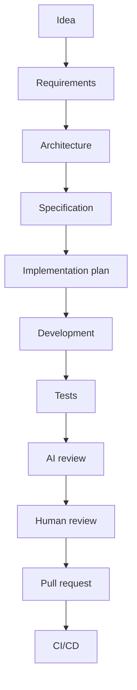

# Lifecycle

## Principles

- Plan before editing. Read the code and its tests, then make the smallest change that meets the requirement.
- Ask when requirements are ambiguous or the requested scope conflicts with the stated goal.
- Keep one concern per change. Do not mix a bug fix with an enhancement.
- Match existing project style, naming, and test patterns.
- Prefer local logic over a premature shared abstraction. Some duplication is better than the wrong abstraction.
- Say so when a requested pattern does not fit the problem, before implementing it.

## Human and AI roles

| Step | AI agent | Human |
| --- | --- | --- |
| Requirements, architecture | Draft, challenge, list risks | Decide |
| Specification and plan | Draft phased plan | Approve |
| Development | Implement approved plan in small steps | Steer |
| Tests | Write and run | Review coverage of intent |
| Review | First pass: correctness, security, standards | Final approval where required |
| Merge and deploy | Prepare the PR | Merge, tag, release |

## Handoffs

When work moves between agents or sessions, state: the goal, constraints, files involved, what is done, what remains, and the commands that verify it. Mark unknowns `TBD`.
