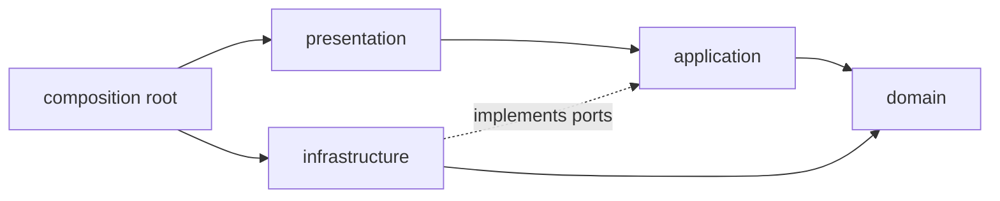

# Clean Architecture

Backend applications use Clean Architecture with hexagonal ports and adapters, organized by feature. The goal is to keep business rules independent of frameworks, databases, and delivery mechanisms so they stay testable and replaceable.

## Layers

| Layer | Holds | Depends on |
| --- | --- | --- |
| Domain | Entities, value objects, validation rules, repository ports | Nothing outside itself |
| Application | Use cases, DTOs, mappers to DTOs, transaction boundaries | Domain |
| Infrastructure | Database models, repositories, HTTP clients, adapters | Domain, application ports |
| Presentation | Routers, request and response schemas | Application |
| Composition root | Wiring of ports to implementations | All of the above |

## Principles

- **Dependency rule**: source dependencies point inward. Inner layers never import outer layers.
- **Ports and adapters**: the domain defines an interface (a port); infrastructure supplies the implementation (an adapter). Only the composition root knows which adapter is used.
- **Feature-first**: each feature owns its layers, so a feature can be understood, tested, and changed in one place. Code moves to `shared/` only after real reuse.
- **Explicit mapping**: domain entities, persistence models, and API DTOs are separate types. Mapping between them is explicit, in standalone mappers.
- **Pragmatism**: apply KISS and YAGNI before DRY and SOLID. Do not add a layer, interface, or pattern that solves a problem you do not have.

Do not apply this structure to small scripts, CRUD-only prototypes with no business rules, or repositories that follow an established different architecture.

Concrete folder layout and rules: [FastAPI structure](../backend/fastapi-structure.md).
