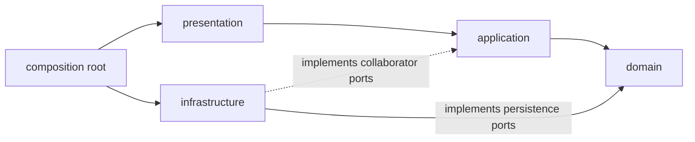
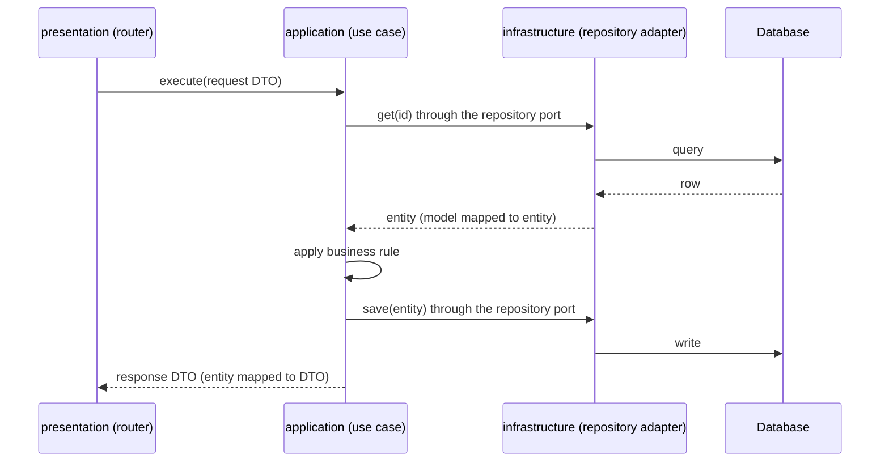

# Clean Architecture

Backend applications use Clean Architecture with hexagonal ports and adapters, organized by feature. The goal is to keep business rules independent of frameworks, databases, and delivery mechanisms so they stay testable and replaceable.

## Layers

| Layer | Holds | Depends on |
| --- | --- | --- |
| Domain | Entities, value objects, validation rules, repository ports | Nothing outside itself |
| Application | Use cases, DTOs, mappers to DTOs, transaction boundaries, ports for non-domain collaborators | Domain |
| Infrastructure | Database models, repositories, HTTP clients, adapters | Domain, application ports |
| Presentation | Routers, request and response schemas | Application |
| Composition root | Wiring of ports to implementations | All of the above |

A port lives in the layer that needs it. Persistence ports describe how the domain stores and loads entities, so they live in `domain`. Ports for external collaborators that only a use case needs, such as an email sender or a payment client, live in `application`.

## Principles

- **Dependency rule**: source dependencies point inward. Inner layers never import outer layers.
- **Ports and adapters**: the domain or application layer defines an interface (a port); infrastructure supplies the implementation (an adapter, see [Design patterns](./design-patterns.md)). Only the composition root knows which adapter is used.
- **Feature-first** ([details](./feature-first.md)): each feature owns its layers, so a feature can be understood, tested, and changed in one place. Code moves to `shared/` only after real reuse.
- **Explicit mapping**: domain entities, persistence models, and API DTOs are separate types. Mapping between them is explicit, in standalone mappers.
- **Pragmatism**: apply KISS and YAGNI before DRY and SOLID. Do not add a layer, interface, or pattern that solves a problem you do not have. See [Design principles](./design-principles.md).

## Request flow

A request passes from the router to the use case to the adapter and back. Entities never reach the router, and the use case never sees HTTP. The composition root injected the adapter behind the port.

## Testing by layer

Each layer has one natural test type, so tests stay fast and failures point to one place. See [testing strategy](../testing/strategy.md).

| Layer | Test type | Notes |
| --- | --- | --- |
| Domain | Unit | Pure logic, no fakes needed |
| Application | Unit | Use in-memory fakes for ports, not mocks of internals |
| Infrastructure | Integration | Real database or service; verifies mapping and queries |
| Presentation | API | Full request path through the router |
| Layer boundaries | Architecture test | Parses imports and fails on forbidden ones ([backend testing](../testing/backend-testing.md)) |

## Common violations

| Violation | Why it hurts | Fix |
| --- | --- | --- |
| Business rule in a router | Cannot be reused or unit tested without HTTP | Move it to the domain or a use case |
| ORM model returned from a route or used in a use case | The database schema leaks into the API and the domain | Map to an entity or DTO in a mapper |
| Use case constructs a repository or client | Hidden dependency, no way to substitute it in tests | Receive the port through the composition root |
| Domain imports SQLAlchemy, FastAPI, or Pydantic | The domain stops being independent of frameworks | Keep framework types in infrastructure and presentation |
| Generic `BaseRepository` with CRUD for every entity | Exposes operations the domain does not need | Write an explicit port per feature |
| Pass-through layer that only forwards calls | Indirection with no behavior | Remove it or call the shared function directly |

## When not to use this structure

Do not apply this structure to small scripts, CRUD-only prototypes with no business rules, or repositories that follow an established different architecture. The layers pay off only when there are business rules to protect; without them they are indirection ([YAGNI](./design-principles.md#yagni)).

Concrete folder layout and rules: [FastAPI structure](../backend/fastapi-structure.md).
