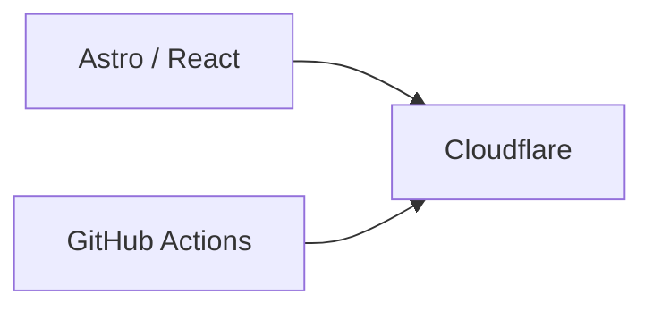
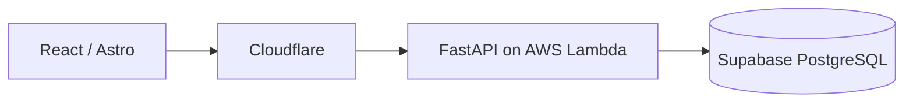
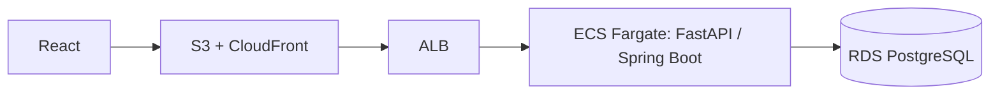

# Deployment profiles

One engineering platform, three deployment profiles. Application architecture, testing, documentation, AI tooling, CI/CD, and conventions stay the same. Only infrastructure changes with scale and budget.

| Profile | Use for | Target cost |
| --- | --- | --- |
| `static` | Portfolios, documentation, marketing sites, landing pages | ~$0 |
| `lean` | Freelance projects, MVPs, small businesses, early-stage SaaS | ~$0–10/month |
| `enterprise` | Large applications, SaaS, scalable systems, AWS depth | Varies |

## Status

Each profile has a Terraform composition root in [terraform-modules](https://github.com/alonsovndev/terraform-modules) under `profiles/`. All three are **validated offline only**: Terraform validation, mocked-provider plan tests, and local builds of the reference applications (`template-docs`, `template-react-vite`, `template-api-python`). None has been applied to a real account, so none is deployment-ready yet and costs are unverified.

## static

Cloudflare handles DNS, SSL, CDN, and static hosting through Workers static assets on an owned domain. GitHub Actions builds the site and Terraform uploads it, so a content change is a reviewed plan and apply.

## lean

Tooling: Cloudflare, AWS Lambda, Supabase PostgreSQL, GitHub Actions, Terraform, Sentry.

The API runs as a container image with the AWS Lambda Web Adapter and reads its database credentials from Secrets Manager at startup ([ADR-005](../adr/adr-005-lean-profile-lambda-container.md)). Rules for managed PostgreSQL:

- Connect through the Supabase pooler (IPv4) with SSL required, and disable SQLAlchemy pooling and prepared-statement reuse behind a transaction-mode pooler.
- Run migrations as a separate one-off step on the direct or session-pooler connection.
- Create the Supabase project and the credentials secret by hand; Terraform does not manage them.
- The web app calls the API Gateway URL directly. A custom API hostname is TBD.

The container conventions in [FastAPI structure](../backend/fastapi-structure.md) apply to the enterprise profile.

## enterprise

Optional: SQS, EventBridge, S3, Secrets Manager, CloudWatch, OpenTelemetry. Authenticate CI to AWS with GitHub OIDC, not long-lived access keys.

- ECS injects the RDS-managed credentials secret into the container, and the connection requires SSL.
- Point the load balancer health check at the liveness endpoint (`/health`), not readiness, so a database outage does not recycle tasks.
- The application initially connects with the RDS master credentials; a least-privilege application user is TBD.

## Release path (static, lean, enterprise)

Terraform owns the API image digest and the Cloudflare assets, so a release is a reviewed plan and apply through the reusable `terraform-plan` and `terraform-apply` workflows. CI roles trust one GitHub environment per repository, never wildcard subjects. The first apply of an API profile bootstraps the ECR repository, pushes an image, then applies the rest.

## Choosing

- Start with the cheapest profile that meets the requirement.
- ECS is preferred over Kubernetes. Use Kubernetes only when enterprise requirements justify it, several services need orchestration, or the project exists to demonstrate it.
- A profile becomes standard only after a real project applies it (TBD). Until then it is validated offline only.

Terraform modules and CI workflows: [Cloud](../cloud/README.md), [CI/CD](../ci-cd/README.md).
