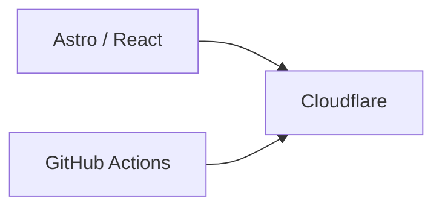
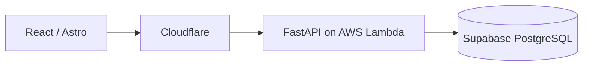
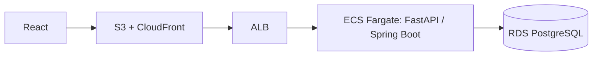

# Deployment profiles

One engineering platform, three deployment profiles. Application architecture, testing, documentation, AI tooling, CI/CD, and conventions stay the same. Only infrastructure changes with scale and budget.

| Profile | Use for | Target cost |
| --- | --- | --- |
| `static` | Portfolios, documentation, marketing sites, landing pages | ~$0 |
| `lean` | Freelance projects, MVPs, small businesses, early-stage SaaS | ~$0–10/month |
| `enterprise` | Large applications, SaaS, scalable systems, AWS depth | Varies |

## static

Cloudflare handles DNS, SSL, CDN, and static hosting. GitHub Actions builds and deploys.

## lean

Tooling: Cloudflare, AWS Lambda, Supabase PostgreSQL, GitHub Actions, Terraform, Sentry.

Lambda packaging for FastAPI (adapter, image versus zip) is TBD; the container conventions in [FastAPI structure](../backend/fastapi-structure.md) apply to the enterprise profile.

## enterprise

Optional: SQS, EventBridge, S3, Secrets Manager, CloudWatch, OpenTelemetry. Authenticate CI to AWS with GitHub OIDC, not long-lived access keys.

## Choosing

- Start with the cheapest profile that meets the requirement.
- ECS is preferred over Kubernetes. Use Kubernetes only when enterprise requirements justify it, several services need orchestration, or the project exists to demonstrate it.
- Validate each profile on a real project before treating it as standard (TBD).

Terraform modules and CI workflows for each profile are planned: [Cloud](../cloud/README.md), [CI/CD](../ci-cd/README.md).
