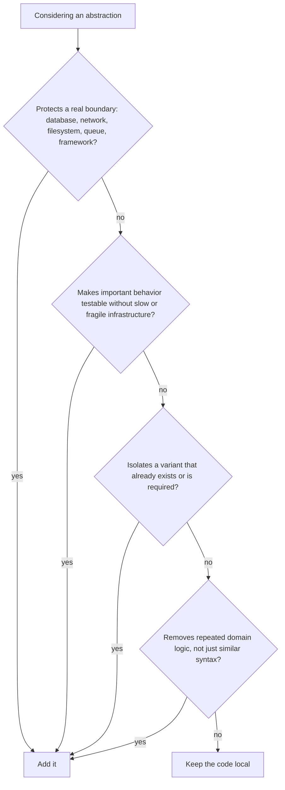

# Design principles

KISS, YAGNI, DRY, and SOLID are tools for trading simplicity against flexibility, not rules to maximize. Apply them in that order: KISS and YAGNI first, DRY and SOLID only when a real problem justifies them.

## Priority order

When principles conflict, the earlier row wins.

| Priority | Principle | Question it answers |
| --- | --- | --- |
| 1 | Correctness and security | Does it work and is it safe? |
| 2 | Project conventions and public contracts | Does it match what callers and teammates already rely on? |
| 3 | KISS | Is this the simplest solution that works? |
| 4 | YAGNI | Is every part of it needed today? |
| 5 | DRY | Is the same knowledge stated in more than one place? |
| 6 | SOLID | Is a boundary missing that causes real coupling or untestable code? |

The reason for the order: an abstraction costs something the moment it is written (more files, more indirection, more to read), while its benefit depends on a future that may not arrive. KISS and YAGNI limit that cost. DRY and SOLID spend it, so they need a problem to pay for it.

## KISS

**Keep it simple.** Choose the simplest design that is correct and that a teammate can read without an explanation.

Why: complexity is paid for on every read, review, and change, not once at write time. Most code is read far more often than it is written.

Apply it:

- Use plain functions and data structures before classes, base classes, or patterns.
- Keep control flow flat; return early with guard clauses.
- Fix an unclear piece of code with a better name or simpler structure before adding a comment.
- Do not bring in framework or architecture machinery for a small local problem.

```python
# Over-built: a registry for one case
class DiscountStrategyRegistry:
    def __init__(self) -> None:
        self._strategies: dict[str, DiscountStrategy] = {}

    def register(self, name: str, strategy: DiscountStrategy) -> None: ...
    def get(self, name: str) -> DiscountStrategy: ...


# Simple: one rule, one function
def apply_member_discount(total: Decimal) -> Decimal:
    return total * Decimal("0.90")
```

Simple does not mean naive. Handling a real failure mode, validating input at a boundary, or using a transaction is not complexity to remove.

## YAGNI

**You aren't gonna need it.** Build for requirements that exist today, not for ones you expect.

Why: speculative features are usually wrong in detail, because the requirement is not known yet. They still have to be read, tested, and maintained, and they harden into constraints that shape later work.

Apply it:

- Do not add flags, extension points, generic type parameters, plugin registries, or configuration knobs for hypothetical needs.
- Do not support formats, transports, storage backends, or workflows nobody asked for.
- Keep an interface narrow until a real consumer needs more.
- Delete unused code. Version control keeps it if it is ever needed.

```python
# Speculative: nothing passes a currency, format, or locale today
def format_price(amount: Decimal, currency: str = "USD", locale: str = "en_US", style: str = "short") -> str: ...


# Current need
def format_price(amount: Decimal) -> str:
    return f"${amount:,.2f}"
```

YAGNI applies to features and flexibility. It does not excuse skipping tests, input validation, authentication, error handling, or a port in front of real I/O such as the database. Those are requirements today. Needing a second database someday is not.

## DRY

**Don't repeat yourself.** Each piece of knowledge (a business rule, a constant, a schema) has one authoritative place.

Why: when the same rule lives in two places, they drift, and one of them becomes a bug.

DRY is about repeated knowledge, not repeated text:

- Two functions that look alike but change for different reasons are not duplication. Merging them couples unrelated things.
- The same business rule written in two features is duplication, even if the code looks different.

Apply it:

- Extract once a second or third real repetition shows the shared concept is stable. Do not extract from a single use.
- Keep duplication when the shared helper would need boolean flags or special cases to serve both callers. A wrong abstraction costs more than a little duplication.
- Test code may repeat setup when it makes each test clearer.

The handbook follows the same rule. Feature code moves to `shared/` only after real reuse ([FastAPI structure](../backend/fastapi-structure.md)), and a documentation rule lives in one page that other pages link to.

## SOLID

SOLID is five guidelines for reducing coupling in object-oriented code. Use each one to fix a coupling or testability problem you have, not to add ceremony.

| Principle | Apply when | Avoid when | Example here |
| --- | --- | --- | --- |
| **S**ingle responsibility | A module changes for unrelated reasons, or mixes domain rules, I/O, and formatting | Splitting only produces tiny files with no clearer boundary | One use case per workflow; routers only translate HTTP |
| **O**pen/closed | A stable extension point has several real variants | One implementation exists and variants are speculative | Add a new adapter behind an existing port without editing use cases |
| **L**iskov substitution | Implementations are consumed through a common contract | Inheritance exists only to share code | An adapter honors its port contract, including errors it raises |
| **I**nterface segregation | Consumers depend on methods they never call | A smaller interface adds indirection without removing coupling | Repository ports have explicit methods, no generic `BaseRepository` |
| **D**ependency inversion | Business logic depends on I/O, a framework, or a concrete adapter | The dependency is local, stable, and not worth abstracting | Ports in the domain or application layer, adapters in infrastructure, wiring in the composition root |

Dependency inversion is the principle behind [Clean Architecture](./clean-architecture.md). It is justified there because the domain must stay testable without a database and replaceable across frameworks. That is a current problem, not a speculative one.

## Abstraction decision test

Before adding an interface, base class, factory, or other [design pattern](./design-patterns.md), check the answers.



If every answer is no, keep the code local and revisit when the second real case appears.

## Warning signs

| Smell | Likely problem | Fix |
| --- | --- | --- |
| A helper takes boolean flags that change what it does | Wrong DRY abstraction | Split into separate functions, or inline |
| An interface has one implementation and no boundary reason | YAGNI | Remove the interface |
| A base class shares code but hides behavior | Inheritance used for reuse | Use composition or a plain function |
| Names like `Manager`, `Processor`, or `Helper` with no domain meaning | Unclear responsibility | Rename after the domain concept, or split |
| A class holds one static method | Unneeded class | Use a module-level function |
| A refactor touches many files but improves no behavior, boundary, or test | Over-engineering | Revert, or narrow the change |

## Related

- [Design patterns](./design-patterns.md): when a named pattern is the right tool.
- [Clean Architecture](./clean-architecture.md): where these principles produce layers, ports, and adapters.
- [Testing strategy](../testing/strategy.md): testability is one of the reasons to add a boundary.
