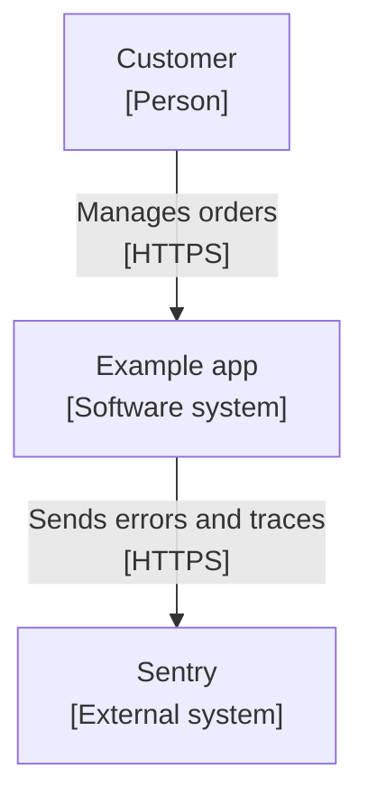
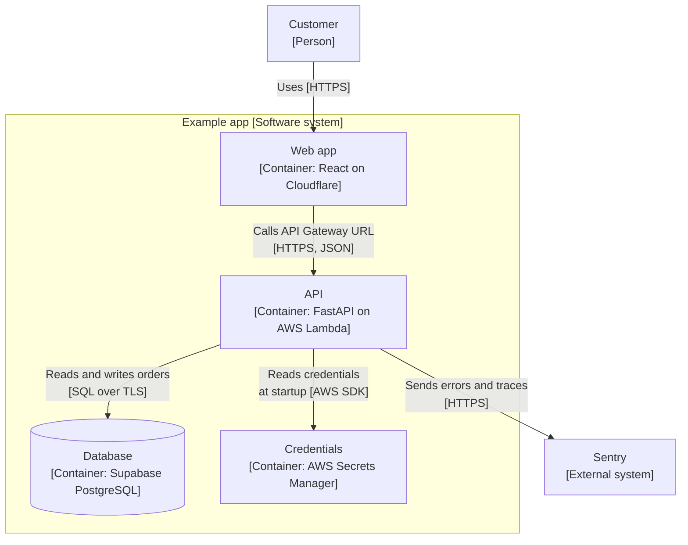
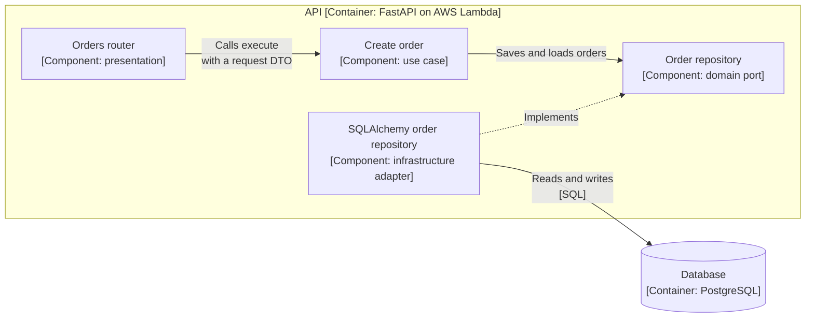

# Documenting architecture

Describe a system's architecture with C4 diagrams, drawn in Mermaid and stored in the repository beside the code. Draw the first three levels as needed: context, containers, and components.

Why: a single "architecture diagram" usually mixes people, deployables, and classes, so it answers no question well. C4 gives each audience one zoom level, and diagrams kept as text are reviewed, versioned, and updated in the same pull request as the change they describe.

## The four levels

C4 describes a system at four zoom levels. Each level shows one kind of element and answers one question.

| Level | Shows | Question it answers | Draw it |
| --- | --- | --- | --- |
| 1. Context | The system, its users, and the external systems it talks to | What is this and who uses it? | Always, for any system others need to understand |
| 2. Container | The deployable or runnable parts: web app, API, database, queue | What runs, and how do the parts communicate? | Always, once there is more than one part |
| 3. Component | The major building blocks inside one container | How is one container organized? | Only for a container that is hard to understand from its code layout |
| 4. Code | Classes and functions | How is this implemented? | Do not draw it. The code, the IDE, and [Clean Architecture](./clean-architecture.md) already show it |

A C4 "container" is a runnable unit such as an API or a database, not a Docker container, although they often coincide.

## Rules for every diagram

- **One level per diagram.** Do not mix people, containers, and classes in one picture.
- **Name every element, give its type, and give its technology**, for example `API [Container: FastAPI on AWS Lambda]`. A box labeled only `Backend` forces readers to guess.
- **Label every arrow** with what flows and how: `Reads and writes orders [SQL over TLS]`. An unlabeled arrow hides the most useful information.
- **Keep the diagram readable on one screen.** If it needs scrolling, split it by zooming into one element at the next level.
- **Show intent, not inventory.** Leave out elements that do not help answer the level's question.

## Drawing C4 in Mermaid

Use Mermaid `flowchart` diagrams with C4 labels. Mermaid also has a native C4 syntax, but it is marked experimental and gives limited control over layout, so it is not used here. Mermaid is the handbook's diagram standard ([writing rules](../intro.md#writing-rules)), and flowcharts render the same as the other diagrams on this site.

Conventions:

- Put the element type and technology on a second line with ` `, and wrap labels in double quotes.
- Draw the system boundary as a `subgraph`.
- Write arrow labels as a verb plus protocol, in double quotes, and break a long label onto two lines with ` `. Mermaid clips an arrow label wider than about 200 pixels.

## Worked example

The example is an illustrative app on the `lean` profile ([Deployment profiles](./deployment-profiles.md)). Names are placeholders.

### Level 1: context

### Level 2: containers

### Level 3: components of the API

Draw this only for a container that needs it. Here it shows one feature's layers, matching [Clean Architecture](./clean-architecture.md).

## Where diagrams live

- Keep each project's diagrams in that project's repository, in Markdown next to the code, not in a separate tool that drifts. The handbook holds the standard; projects hold their own diagrams.
- Exact file location in a project (for example `docs/architecture.md`): TBD.
- Update the diagram in the same pull request as the change that makes it wrong. This follows the [definition of done](../ai-development/definition-of-done.md): docs that describe changed behavior are updated in the same pull request.

## Diagrams and decisions

A diagram shows what the system is; an [ADR](../adr/README.md) records why it is that way. Link them: name the ADR in a caption under the diagram when a structure comes from a decision, such as splitting out a service ([Monolith or services](./monolith-or-services.md)). When a change alters a container or an external dependency, update the diagram and add an ADR if it is an architectural decision.

## Common mistakes

| Mistake | Why it hurts | Fix |
| --- | --- | --- |
| Mixing levels in one diagram | It answers no audience's question | Split by level |
| Unlabeled arrows | Readers cannot tell what flows or over which protocol | Label with a verb and the protocol |
| Technology missing from boxes | Readers cannot tell what runs where | Add the type and technology |
| Drawing level 4 | It repeats the code and goes stale quickly | Link to the code instead |
| A component diagram for every container | Maintenance cost with little value | Draw it only where the code layout is not enough |
| A diagram never updated | A wrong diagram is worse than none | Change it in the same pull request as the code |
| Treating the diagram as the decision | The reason is lost | Record the reason in an ADR |

## Related

- [Clean Architecture](./clean-architecture.md): what the component level of a backend container shows.
- [Deployment profiles](./deployment-profiles.md): the infrastructure that appears as containers.
- [Design principles](./design-principles.md): draw only what answers a question, as with any abstraction.
