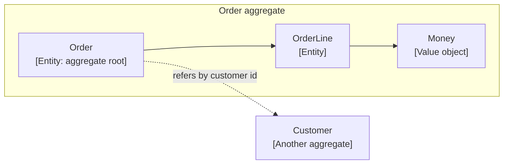

# Domain modeling

Use a small set of Domain-Driven Design (DDD) building blocks inside the `domain` layer: entities, value objects, aggregates, domain services, and repository ports. Use them where there are business rules to protect, and skip the vocabulary where there are none.

Why: business rules scattered across routers, use cases, and database triggers drift apart and cannot be tested without a framework. A domain model keeps each rule in one place, written in the language of the business, and testable with plain Python.

This page covers the model inside the layer. The layers themselves are in [Clean Architecture](./clean-architecture.md), and when to skip them is in [When not to use this structure](./clean-architecture.md#when-not-to-use-this-structure).

## Building blocks

| Block | What it is | Equality | Lives in |
| --- | --- | --- | --- |
| Entity | An object with an identity that persists as its state changes, such as an order | By identity (its id) | `domain` |
| Value object | An immutable object defined only by its values, such as money or an email address | By value | `domain` |
| Aggregate | A cluster of entities and value objects changed together, with one root entity | Root by identity | `domain` |
| Domain service | A stateless business operation that does not belong to one entity | Not applicable | `domain` |
| Repository port | An interface to load and save aggregates | Not applicable | `domain` ([ports](./clean-architecture.md#layers)) |

Domain events are not covered here: TBD.

The domain layer imports only the standard library ([FastAPI structure](../backend/fastapi-structure.md#dependency-direction)), and entities are separate classes from ORM models and DTOs, so they are not Pydantic or ORM models. Pydantic belongs to the presentation layer and ORM models to infrastructure. As guidance, not a standard: write entities as plain classes and value objects as frozen `dataclass` types.

## Ubiquitous language

Name classes, methods, and fields with the words the business uses, and use the same words in the API, logs, and conversation. `order.confirm()` beats `order.set_status(2)`.

Why: when code and business use different words, rules get mistranslated. The business event names in [Logging](../backend/logging.md), such as `story.created`, use domain words for the same reason.

## Entities

An entity has an identity and behavior. It enforces its own rules and keeps its state private, so callers change it only through methods that check the rules.

```python
from uuid import UUID


class OrderAlreadyConfirmedError(Exception):
    pass


class EmptyOrderError(Exception):
    pass


class Order:
    def __init__(self, order_id: UUID) -> None:
        self.order_id = order_id
        self._lines: list["OrderLine"] = []
        self._confirmed = False

    @property
    def lines(self) -> tuple["OrderLine", ...]:
        return tuple(self._lines)

    @property
    def confirmed(self) -> bool:
        return self._confirmed

    def add_line(self, line: "OrderLine") -> None:
        if self._confirmed:
            raise OrderAlreadyConfirmedError(self.order_id)
        self._lines.append(line)

    def confirm(self) -> None:
        if not self._lines:
            raise EmptyOrderError(self.order_id)
        self._confirmed = True

    def __eq__(self, other: object) -> bool:
        return isinstance(other, Order) and self.order_id == other.order_id

    def __hash__(self) -> int:
        return hash(self.order_id)
```

The rule "a confirmed order cannot change" lives in the entity. A use case calls `order.add_line(...)` and never checks the flag itself. Equality is by identity, so two `Order` objects with the same `order_id` are the same order even if their lines differ in memory. The snippet omits the `OrderLine` entity.

## Value objects

A value object is immutable and validates itself when created. Two value objects with the same values are interchangeable.

```python
from dataclasses import dataclass
from decimal import Decimal


class NegativeAmountError(Exception):
    pass


class CurrencyMismatchError(Exception):
    pass


@dataclass(frozen=True)
class Money:
    amount: Decimal
    currency: str

    def __post_init__(self) -> None:
        if self.amount < 0:
            raise NegativeAmountError(self.amount)

    def add(self, other: "Money") -> "Money":
        if other.currency != self.currency:
            raise CurrencyMismatchError(other.currency)
        return Money(self.amount + other.amount, self.currency)
```

Use a value object when a primitive carries a rule or a unit: money, email address, percentage, date range. A plain `str` for an email lets invalid data travel through the whole system. Do not wrap every field; a name that has no rule can stay a `str` ([KISS](./design-principles.md#kiss)).

## Aggregates

An aggregate is a group of objects treated as one unit for changes. All access goes through the root, and the root guarantees the rules across the group.



Guidance for sizing and using aggregates (not yet standards):

- Keep aggregates small. Include only what must be consistent together.
- Reference other aggregates by id, not by holding the object.
- Load and save an aggregate through one repository port, and change one aggregate per transaction. The transaction boundary lives in the use case ([Clean Architecture](./clean-architecture.md#layers)).
- Do not reach inside an aggregate to change a child. Call a method on the root.

## Domain services

When a business rule spans several entities and fits none of them, put it in a stateless domain service, for example pricing an order against a discount policy. Use this sparingly: if the logic fits an entity or a value object, put it there.

| Where the logic goes | When |
| --- | --- |
| Entity or value object method | The rule needs the data of one object |
| Domain service | A business rule spans several objects and fits none of them |
| Use case (`application`) | Orchestration: load, call domain logic, save, map to a DTO. Business rules and invariants stay in the domain |

## Where validation lives

Each layer validates its own concern, and none replaces the others.

| Concern | Where | Example |
| --- | --- | --- |
| Request shape and types | `presentation` (Pydantic schemas) | The `quantity` field is an integer |
| Business rules and invariants | `domain` | A confirmed order cannot change |
| Persistence integrity | Database constraints | A foreign key, a unique index |

Domain code uses only the standard library. As guidance, not a standard: raise named exception types from the domain, as in the examples above, and have the presentation layer translate them to status codes such as 409 or 422 ([REST API](../backend/rest-api.md)). The exact error shape is TBD there.

## Bounded contexts and features

A bounded context is a boundary within which one model and one vocabulary apply. The same word can mean different things in different contexts: a "customer" in billing is not the same object as a "customer" in shipping.

In this handbook, a [feature](./feature-first.md) owns its layers, including its domain. As guidance, not a standard: treat a feature as the unit that owns its model, and do not share one entity class across features to avoid duplication. Two features that both need customer data each model what they need, and share only what is truly common after real reuse ([DRY](./design-principles.md#dry)). Whether a bounded context spans one feature or several: TBD.

## Anemic models

An anemic model has entities that only hold data, while the rules sit in use cases or helpers. The data can then be changed into invalid states from anywhere.

| Mistake | Why it hurts | Fix |
| --- | --- | --- |
| Entity with only fields; rules in the use case | Rules are duplicated and bypassed | Move the rule into an entity method |
| Primitives for rule-bearing concepts | Invalid values travel through the system | Introduce a value object |
| Setters that expose every field | Any caller can break an invariant | Expose named behavior (`confirm`) instead |
| One huge aggregate | Slow, contended, hard to change | Split it and reference by id |
| Pydantic or ORM models as domain entities | The domain depends on a framework | Separate classes with mappers |
| DDD vocabulary on a CRUD feature | Ceremony without rules to protect | Keep it as a plain repository and schema |

## Testing the model

Domain tests are unit tests with no database, framework, or fakes, because the domain depends on nothing outside itself ([testing by layer](./clean-architecture.md#testing-by-layer)). Test each rule by name:

```python
from uuid import uuid4

import pytest


def test_confirmed_order_rejects_new_lines():
    order = Order(order_id=uuid4())
    order.add_line(an_order_line())
    order.confirm()

    with pytest.raises(OrderAlreadyConfirmedError):
        order.add_line(an_order_line())
```

`an_order_line()` is a test builder ([testing strategy](../testing/strategy.md)).

## Related

- [Clean Architecture](./clean-architecture.md): the layers around the domain.
- [Feature-first organization](./feature-first.md): the boundary that owns each model.
- [Design principles](./design-principles.md): why rules go in one place, and why to stay simple.
