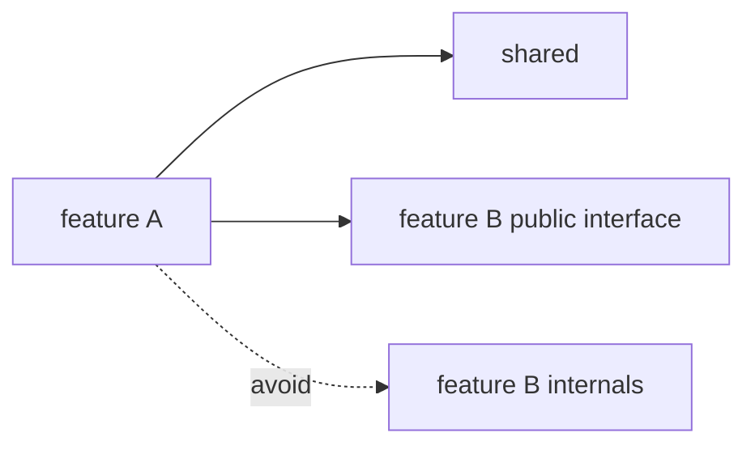

# Feature-first organization

Organize code by feature, the business capability it serves, not by technical type. Each feature owns everything it needs: its layers on the backend, its components, hooks, API calls, and types on the frontend.

Why: a change request is almost always about a feature ("let users reset a password"), not about a technical layer. When a feature lives in one place, you can understand, test, and change it without hunting across the whole codebase.

## Feature-first versus type-first

```text
# Type-first: one change touches every folder
routers/        users.py  orders.py
services/       users.py  orders.py
repositories/   users.py  orders.py
models/         users.py  orders.py

# Feature-first: one change stays in one folder
features/
  users/    domain/  application/  infrastructure/  presentation/
  orders/   domain/  application/  infrastructure/  presentation/
```

Type-first layouts look tidy at first, but they spread each feature across the tree, and unrelated features end up sharing files. Feature-first keeps the [Clean Architecture](./clean-architecture.md) layers, but inside each feature rather than across the whole application.

Concrete layouts: [FastAPI structure](../backend/fastapi-structure.md) and [React + Vite + Ant Design](../frontend/react-vite-antd.md). This page covers the reasoning and the boundaries, not the folder trees.

## Sizing a feature

A feature is one business capability whose parts change together. These tests are heuristics, not standards.

| Test | Healthy | Warning sign |
| --- | --- | --- |
| Describe it in one sentence | "Manage user accounts" | The sentence needs "and" to connect unrelated things |
| Change frequency | Its files change together | Half of its files change for reasons unrelated to the other half |
| Dependencies on other features | A few, through public interfaces | It reaches into many other features |
| Name | A domain noun such as `orders` | A technical word such as `utils`, `services`, or `common` |

Split a feature when it fails the first two tests. Merge two features when neither can change without the other.

## Dependencies between features



- **Frontend (standard)**: features import from other features only through their `index.ts` ([React + Vite + Ant Design](../frontend/react-vite-antd.md)).
- **Backend**: the rule for one feature calling another is TBD. As guidance, not a standard, avoid importing another feature's infrastructure or ORM models.
- **Shared code and features**: whether `shared/` may import from a feature is TBD. Guidance, not a standard: shared code exists to serve several features, so depending on one of them defeats its purpose.

## Moving code to shared

Code starts in the feature that needs it and moves to `shared/` only after real reuse. The frontend moves code once it is reused in two or three places ([React + Vite + Ant Design](../frontend/react-vite-antd.md)); the backend sets no numeric threshold. This is [DRY](./design-principles.md#dry) applied to folders: a premature `shared/` couples features to a guess about what they have in common.

Backend `shared/` holds cross-feature ports, persistence base, logging, and pure helpers ([FastAPI structure](../backend/fastapi-structure.md)).

## Common mistakes

| Mistake | Why it hurts | Fix |
| --- | --- | --- |
| Top-level type folders (`services/`, `utils/`) beside `features/` | Features leak back into a type-first layout | Put the code inside the feature that uses it |
| `common/` or `utils/` as a dumping ground | Nothing owns it, so everything depends on it | Move code to its feature, or to `shared/` with a clear purpose |
| One feature imports another's internals | Hidden coupling; changing one breaks the other | Use the other feature's public interface |
| Moving code to `shared/` after one use | Couples features to a guess | Wait for real reuse |
| A feature named after a layer, such as `repositories` | The layout is type-first again | Name features after business capabilities |

## Related

- [Clean Architecture](./clean-architecture.md): the layers inside each feature.
- [Monolith or services](./monolith-or-services.md): clear feature boundaries are what make a later split possible.
- [Design principles](./design-principles.md): why shared code waits for real reuse.
