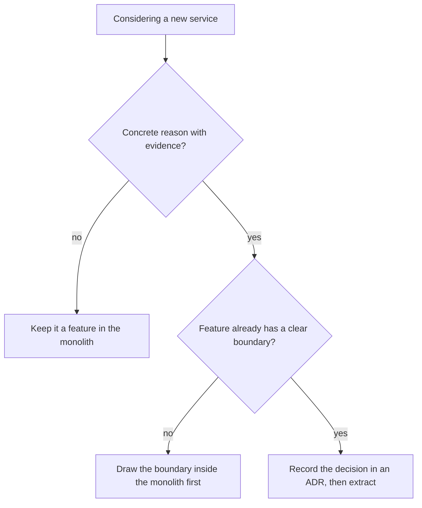

# Monolith or services

Start with one deployable application organized into well-separated features (a modular monolith). Split into separate services only for a concrete, measured reason.

Status: proposed in [ADR-008](../adr/adr-008-modular-monolith-by-default.md). Until that ADR is accepted, treat this page as guidance, not a standard.

Why: splitting an application into services adds costs on day one: network failures between components, versioned contracts, distributed tracing, separate deployments, data consistency across stores, and a harder local setup. The benefits (independent scaling, independent releases) depend on a future that may not arrive. This is [KISS and YAGNI](./design-principles.md) applied to system structure.

## Options

| Option | What it is | When it fits |
| --- | --- | --- |
| Monolith without internal boundaries | One deployable, code mixed together | Small scripts and throwaway prototypes only |
| Modular monolith (default) | One deployable, features with clear boundaries ([feature-first](./feature-first.md)) | Most projects: MVPs, SaaS products, internal tools |
| Services | Several independently deployed applications | A concrete reason from the next section applies |

A modular monolith keeps the benefit people want from services, clear boundaries between parts, without the network between them.

## Reasons to split

Split a service out only when you can name the reason and show evidence for it.

| Reason | Evidence to ask for |
| --- | --- |
| One component needs to scale differently from the rest | Measured load or cost, not an expected one |
| A component needs a different runtime, language, or hardware | A requirement the main runtime cannot meet |
| Teams need to release independently | Teams are blocked on each other's releases today |
| A failure in one component must not take down the rest | A past incident, or a hard availability requirement |
| Compliance requires isolating data or access | A written requirement |

These are not reasons: "it might need to scale someday", "microservices are modern", or "the boundaries would be cleaner". Clean boundaries come from features and ports, which a monolith already has.

## What the profiles use today

The [deployment profiles](./deployment-profiles.md) run one backend service each, next to a separate web app:

- `lean`: one FastAPI API on AWS Lambda ([ADR-005](../adr/adr-005-lean-profile-lambda-container.md)).
- `enterprise`: one FastAPI or Spring Boot service on ECS Fargate.
- `static`: a site only, with no backend.

ECS is preferred over Kubernetes. Kubernetes is used only when enterprise requirements justify it, several services need orchestration, or the project exists to demonstrate it.

## Keeping a split possible

Design the monolith so a feature could be extracted later, without building for the split now:

- Keep each feature's layers and code together ([feature-first](./feature-first.md)).
- Have other code depend on a feature's public interface, not its internals.
- Keep external collaborators behind [ports](./clean-architecture.md#layers), so moving a call from in-process to over the network changes an adapter, not business rules.
- Which feature owns which database tables, and whether features may join across them: TBD.

## Record the decision

Choosing to split, or to adopt Kubernetes, is a decision. Record it in the project's own ADR with the reason and the evidence from the table above, so the cost is accepted knowingly. The format is the handbook's [ADR template](../adr/adr-template.md).

## Related

- [Feature-first organization](./feature-first.md): the boundaries inside the monolith.
- [Design principles](./design-principles.md): why simpler comes first.
- [Deployment profiles](./deployment-profiles.md): the infrastructure each option runs on.
