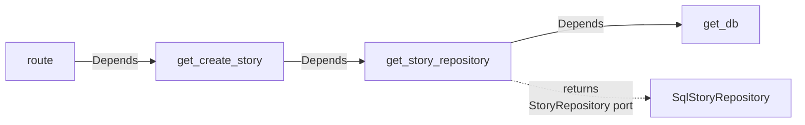

# Dependency injection

A class receives its collaborators through its constructor, typed as ports. Only the composition root creates the objects and decides which adapter backs each port.

Why: a class that builds its own repository or client has a hidden dependency. It cannot be tested without the real database or service, and swapping an adapter means editing the code that uses it. Passing dependencies in keeps use cases independent of infrastructure and makes the fake in a unit test a one-line change.

This page shows how the rules in [FastAPI structure](./fastapi-structure.md#rules) fit together. The layers and ports are in [Clean Architecture](../architecture/clean-architecture.md).

## Rules

Existing standards ([FastAPI structure](./fastapi-structure.md#rules)):

- Build the object graph only in `composition/`. Routes receive wired objects through `Depends(...)`; they never construct repositories, services, or use cases.
- Factories return port types, not implementations.

Guidance, not a standard:

- Use constructor injection. A use case or adapter declares what it needs as constructor parameters and never creates it.
- Type each parameter as the port (the `ABC`), not an implementation.
- Avoid global instances and service locators (a registry that a class queries for its dependencies). See [Singleton](../architecture/design-patterns.md#singleton).

The rest of the page explains how to apply them.

## Worked example

A `story` feature with one use case. The port lives in `domain` because it describes how stories are stored ([ports](../architecture/clean-architecture.md#layers)).

```python
# features/story/domain/repositories.py
from abc import ABC, abstractmethod


class StoryRepository(ABC):
    @abstractmethod
    async def add(self, story: "Story") -> None: ...
```

The use case depends on the port and nothing else. It takes a request DTO plus context, as in [FastAPI structure](./fastapi-structure.md#rules).

```python
# features/story/application/create_story.py
from uuid import UUID, uuid4


class CreateStory:
    def __init__(self, repository: StoryRepository) -> None:
        self._repository = repository

    async def execute(self, request: "CreateStoryRequest", created_by: UUID) -> "StoryResponse":
        story = Story(story_id=uuid4(), title=request.title, created_by=created_by)
        await self._repository.add(story)
        return to_story_response(story)
```

The adapter implements the port in `infrastructure`.

```python
# features/story/infrastructure/repositories.py
class SqlStoryRepository(StoryRepository):
    def __init__(self, session: AsyncSession) -> None:
        self._session = session

    async def add(self, story: Story) -> None:
        self._session.add(StoryMapper.to_model(story))
```

The composition root wires them. `get_db` is the session dependency from [Database and migrations](./database-and-migrations.md#sqlalchemy). Each factory declares its own dependencies with `Depends`, so FastAPI builds the chain for every request. Use cases have no port, so their factories return the use case class.

```python
# composition/story.py
def get_story_repository(session: AsyncSession = Depends(get_db)) -> StoryRepository:
    return SqlStoryRepository(session)


def get_create_story(repository: StoryRepository = Depends(get_story_repository)) -> CreateStory:
    return CreateStory(repository)
```

The route asks for the use case and passes the DTO through. `get_current_user_id` stands for the authentication dependency, which this page does not cover.

```python
# features/story/presentation/router.py
@router.post("/stories", status_code=201)
async def create_story(
    request: CreateStoryRequest,
    created_by: UUID = Depends(get_current_user_id),
    use_case: CreateStory = Depends(get_create_story),
) -> StoryResponse:
    return await use_case.execute(request, created_by)
```



Only `get_story_repository` names `SqlStoryRepository`. Replacing the adapter changes that one function.

The snippets do not commit the session. Where the transaction commits is TBD ([Database and migrations](./database-and-migrations.md#sqlalchemy)).

The snippets omit imports, the `Story` entity, the DTOs, and the mapper. FastAPI, SQLAlchemy, and Pydantic are not installed in this repository, so the snippets that use them are illustrative.

## Where `Depends` belongs

| Layer | May use `Depends` | Reason |
| --- | --- | --- |
| `domain` | No | The domain imports only the standard library ([dependency direction](./fastapi-structure.md#dependency-direction)) |
| `application` | No (guidance, not a standard) | A use case that imports FastAPI is tied to HTTP and cannot run from a batch job or a unit test without the framework |
| `infrastructure` | No (guidance, not a standard) | Adapters receive their dependencies in the constructor, like use cases |
| `presentation` | Yes | Routes declare what they need |
| `composition` | Yes | Factories chain through `Depends` |

## Lifetimes

As guidance, not a standard: match each object's lifetime to what it holds.

| Object | Lifetime | Why |
| --- | --- | --- |
| Settings | Application | Read once at startup ([Python standards](./python-standards.md#environments)) |
| HTTP clients, connection engine | Application | Expensive to create; safe to share |
| Database session | Request | Holds one unit of work; sharing it across requests mixes transactions |
| Repositories, use cases | Request | Cheap to build; they hold the request's session |

Create application-lifetime objects once at startup and hand them to the factories. Do not create them at import time, because tests and tools that import the module would trigger real connections.

## Outside HTTP

Batch jobs and scripts have no `Depends`. As guidance, not a standard: the entry point builds the graph by calling plain factory functions instead of `Depends`, and keeps those factories in `composition/`. Batch jobs use a sync `Session` ([Database and migrations](./database-and-migrations.md#sqlalchemy)), while the example port above is async, so a sync adapter cannot implement it. Whether a feature shares use cases between the API and a batch job, or keeps separate sync ports: TBD.

## Testing

Because use cases take ports, a unit test builds one directly with an in-memory fake and needs no framework or override ([testing by layer](../architecture/clean-architecture.md#testing-by-layer)).

```python
class InMemoryStoryRepository(StoryRepository):
    def __init__(self) -> None:
        self.stories: list[Story] = []

    async def add(self, story: Story) -> None:
        self.stories.append(story)


async def test_create_story_saves_the_story():
    repository = InMemoryStoryRepository()
    use_case = CreateStory(repository)

    await use_case.execute(a_create_story_request(), created_by=uuid4())

    assert len(repository.stories) == 1
```

API tests keep the real route and swap the port with `app.dependency_overrides` ([backend testing](../testing/backend-testing.md#rules)).

```python
fake_repository = InMemoryStoryRepository()
app.dependency_overrides[get_story_repository] = lambda: fake_repository
```

Override the factory that returns the port, not the use case, so the test still exercises the use case, and keep a reference to the fake to assert on it. Clear `app.dependency_overrides` after each test. The `async` unit test above needs an async test runner plugin; which one: TBD.

## Common mistakes

| Mistake | Why it hurts | Fix |
| --- | --- | --- |
| Use case creates its own repository or client | Hidden dependency; cannot be substituted in tests | Receive the port in the constructor |
| Module-level instance imported wherever needed | Shared mutable state; initialization order matters | Create once in the composition root and pass it in |
| Service locator: use case calls `container.get(StoryRepository)` | The dependency is still hidden, just behind a lookup | Declare it as a constructor parameter |
| Route builds a repository or use case | Business wiring leaks into presentation | Add a factory in `composition/` and use `Depends` |
| Factory returns `SqlStoryRepository` | Callers depend on the adapter | Return the `StoryRepository` port |
| Use case takes an `AsyncSession` | The application layer imports SQLAlchemy, so use cases are tied to the database library ([layers](../architecture/clean-architecture.md#layers)) | Take a port. How a use case commits: TBD ([Database and migrations](./database-and-migrations.md#sqlalchemy)) |
| Constructor with many dependencies (guidance, not a standard) | The class likely does too much | Split the use case ([design principles](../architecture/design-principles.md)) |
| Adding a DI container library for a small graph (guidance, not a standard) | Indirection with no problem to solve ([YAGNI](../architecture/design-principles.md#yagni)) | Use plain constructors and `Depends`. A new dependency needs a stated reason and approval |

## Related

- [FastAPI structure](./fastapi-structure.md): the layout and the composition rules.
- [Clean Architecture](../architecture/clean-architecture.md): ports, adapters, and the dependency rule.
- [Design patterns](../architecture/design-patterns.md): Singleton and factory functions returning a port.
- [Backend testing](../testing/backend-testing.md): fakes, overrides, and architecture tests.
