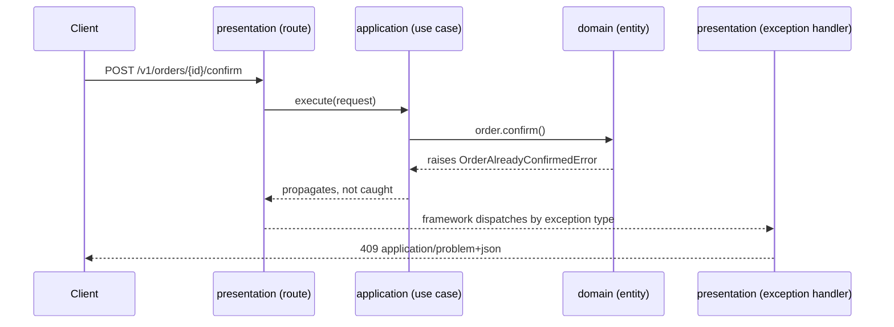

# Error handling

Each layer reports failures in its own terms, and one place in the presentation layer translates them to HTTP responses. The domain raises named exceptions, and only the presentation layer knows status codes.

Why: when a domain rule raises `HTTPException`, the rule is tied to the web framework and cannot run from a batch job or a unit test. When every route builds its own error body, clients get a different shape from each endpoint. Translating at one boundary keeps the rules reusable and the responses uniform.

This page covers how errors move through the layers. The status codes are in [REST API](./rest-api.md), and the proposed error shape is in [ADR-009](../adr/adr-009-problem-details-for-error-responses.md). The validation rules by layer are in [Domain modeling](../architecture/domain-modeling.md#where-validation-lives).

## Rules

Existing standards:

- Return one error shape from every endpoint ([REST API](./rest-api.md#errors)). The shape is still `TBD`; the proposal is [ADR-009](../adr/adr-009-problem-details-for-error-responses.md).
- Never leak internals on a 500 ([REST API](./rest-api.md#status-codes)).
- Log an exception once, where it is handled, with the stack trace ([Logging](./logging.md#rules)).

Guidance, not a standard:

- The domain raises named exceptions, one per business rule, as in [Domain modeling](../architecture/domain-modeling.md#entities). Name them for the business concept, with the suffix `Error`.
- Only `presentation` imports `fastapi` or raises `HTTPException`. Other layers raise their own exceptions.
- An adapter translates the library errors it understands into domain or application exceptions and lets the rest propagate. Chain them with `raise ... from error` so the cause stays in the log.
- Catch an exception only where you can handle it or translate it. Do not catch `Exception` to hide a failure.
- Map each exception type to a status code in one place, not in each route.

## How an error flows



| Layer | Role in error handling |
| --- | --- |
| `domain` | Raises named exceptions for broken rules. Imports only the standard library. |
| `application` | Raises an exception when a lookup finds nothing, such as `StoryNotFoundError`. Lets domain exceptions propagate. |
| `infrastructure` | Translates library errors (a unique-constraint violation, a client timeout) into domain or application exceptions. |
| `presentation` | Registers exception handlers that build the error response. |

## Mapping errors to status codes

The status codes are defined in [REST API](./rest-api.md#status-codes). As guidance, not a standard, choose the code by what went wrong:

| What went wrong | Status | Example |
| --- | --- | --- |
| The resource does not exist | 404 | `StoryNotFoundError` |
| The request conflicts with current state | 409 | `OrderAlreadyConfirmedError` |
| A value breaks a business rule | 422 | `NegativeAmountError` |
| The request shape or types are invalid | 422 (see [400 or 422](#400-or-422)) | Pydantic `RequestValidationError` |
| Credentials are missing or invalid | 401 | Authentication dependency |
| The caller is not allowed | 403 | Authorization dependency |
| Anything unexpected | 500 | A bug or a failed dependency |

Consider answering 404 instead of 403 when revealing that a resource exists is itself sensitive. Authorization rules belong in [Security](../security/README.md).

## Error response shape

[ADR-009](../adr/adr-009-problem-details-for-error-responses.md) proposes RFC 9457 problem details. It is Proposed, so treat the shape below as a draft until the ADR is accepted.

```json
{
  "type": "https://example.com/problems/order-already-confirmed",
  "title": "Order already confirmed",
  "status": 409,
  "requestId": "3f2b8c1e-6d1a-4a53-9f55-0c1d2e3f4a5b"
}
```

`example.com` is a placeholder. The `type` format, the item shape of the `errors` list used for validation failures, and `instance` are `TBD` in the ADR.

## FastAPI wiring

Keep the mapping as data and the handler thin. The handler never uses `str(error)` as the response text, because exception messages can contain internal details.

```python
# features/order/presentation/errors.py
from dataclasses import dataclass


@dataclass(frozen=True)
class ProblemSpec:
    status: int
    type: str
    title: str


ORDER_ALREADY_CONFIRMED = ProblemSpec(
    status=409,
    type="https://example.com/problems/order-already-confirmed",
    title="Order already confirmed",
)


def problem_body(spec: ProblemSpec, request_id: str, **extensions: object) -> dict[str, object]:
    return {
        "type": spec.type,
        "title": spec.title,
        "status": spec.status,
        "requestId": request_id,
        **extensions,
    }
```

The response builder and the registration use FastAPI, so they belong in `presentation`. `get_request_id` stands for reading the ID that the request-ID middleware from [Logging](./logging.md#rules) stored for the request. How it is exposed: `TBD`.

```python
from fastapi import FastAPI, Request
from fastapi.responses import JSONResponse


def problem_response(request: Request, spec: ProblemSpec, **extensions: object) -> JSONResponse:
    body = problem_body(spec, get_request_id(request), **extensions)
    return JSONResponse(body, status_code=spec.status, media_type="application/problem+json")


def register_problem(app: FastAPI, error_type: type[Exception], spec: ProblemSpec) -> None:
    async def handler(request: Request, error: Exception) -> JSONResponse:
        return problem_response(request, spec)

    app.add_exception_handler(error_type, handler)
```

`main.py` stays limited to app creation and registration ([FastAPI structure](./fastapi-structure.md#layout)), so it calls one registration function per feature, for example `register_problem(app, OrderAlreadyConfirmedError, ORDER_ALREADY_CONFIRMED)`.

Registering an exception type means `presentation` imports it. The [dependency table](./fastapi-structure.md#dependency-direction) lets `presentation` import `application` and `shared`, and not domain entities directly. It does not say whether domain exception types are allowed. How `presentation` gets them (for example `application` re-exporting the exceptions it lets propagate, or an allowed import from `domain`): `TBD`, and either choice means a change to FastAPI structure.

Three handlers cover errors that no feature raises. Where these cross-feature handlers live: `TBD`.

- **Validation failures.** FastAPI's default response for `RequestValidationError` does not use the shared shape, so override it. Pydantic's error entries include the rejected input value, so copy only the field and the message into the response.
- **Framework HTTP errors.** Override the handler for Starlette's `HTTPException`, so an unknown route or a disallowed method also returns the shared shape. Copy `error.headers` onto the response, because a 405 carries `Allow` and a 401 can carry `WWW-Authenticate`.
- **Unexpected exceptions.** Register a handler for `Exception` that logs the error once with its stack trace and returns a 500 with a fixed title and no details. Starlette runs this handler outside user middleware and re-raises the exception afterwards, so the server may log it again and the request ID may not be available to it. Both are `TBD`.

```python
async def handle_unexpected(request: Request, error: Exception) -> JSONResponse:
    logger.error("api.unhandled_error", exc_info=error)
    return problem_response(request, INTERNAL_ERROR)
```

The event name is an example. The snippets are illustrative and omit imports and the `INTERNAL_ERROR` spec.

Log level for errors that map to a 4xx response: `TBD`.

## 400 or 422

[REST API](./rest-api.md#status-codes) lists 400 for a malformed request and 422 for failed validation, but does not define the boundary. FastAPI returns 422 for both invalid JSON and failed validation by default, so a 400 is produced only if you add a handler for it. Where the boundary sits: `TBD`.

## Common mistakes

| Mistake | Why it hurts | Fix |
| --- | --- | --- |
| `HTTPException` raised in the domain or a use case | The rule is tied to the web framework | Raise a named exception and map it in `presentation` |
| Each route builds its own error body | Clients get a different shape per endpoint | Register one handler per exception type |
| `str(error)`, a stack trace, or SQL in the response | Leaks internals to callers | Return a fixed title; log the detail once |
| Catching `Exception` and returning `None` or `False` | The failure disappears and the caller carries on | Catch specific exceptions where you can handle them |
| Logging and re-raising in every layer | The same error appears many times in the logs | Log once where it is handled |
| Clients branching on the `title` or `detail` text | Wording changes break clients | Branch on `type` and `status` |
| Returning 200 with an error in the body | Clients, caches, and monitors treat it as success | Use the matching status code |
| Matching on exception message text | Breaks when the wording changes | Match on the exception type |

## Testing

A domain test asserts the exception, with no framework ([Domain modeling](../architecture/domain-modeling.md#testing-the-model)). An API test asserts the status, the media type, and `type`, and checks that nothing internal leaks. [Backend testing](../testing/backend-testing.md#rules) already requires validation-error and not-found paths for every endpoint.

```python
def test_missing_story_returns_problem_details(client):
    response = client.get(f"/v1/stories/{uuid4()}")

    assert response.status_code == 404
    assert response.headers["content-type"] == "application/problem+json"
    assert response.json()["type"] == "https://example.com/problems/story-not-found"
```

## Related

- [REST API](./rest-api.md): status codes and the error shape.
- [ADR-009](../adr/adr-009-problem-details-for-error-responses.md): the proposed shape.
- [Domain modeling](../architecture/domain-modeling.md): named exceptions and where validation lives.
- [Logging](./logging.md): log once, request IDs.
