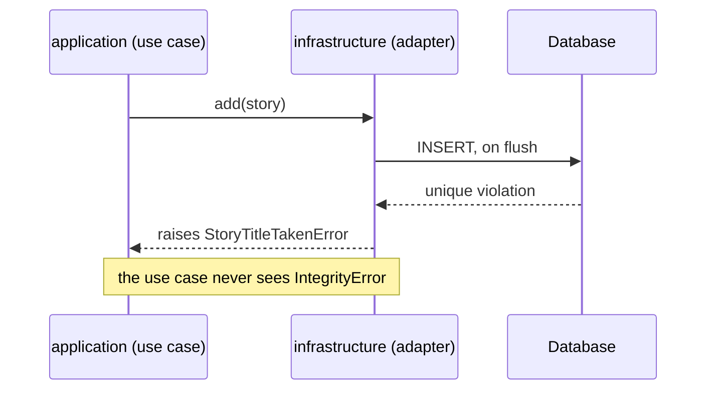

# Persistence patterns

A repository adapter in `infrastructure` implements a domain port with SQLAlchemy, maps between ORM models and domain entities, and translates database errors into domain errors. It never commits and never lets an ORM model leave it.

Why: the domain describes how entities are stored and loaded, and the database library is a detail behind that description. Keeping the translation inside the adapter means use cases, routes, and tests never see SQLAlchemy types or database error codes.

This page shows how the adapter fits together. The table conventions, the session setup, and migrations are in [Database and migrations](./database-and-migrations.md). The aggregate rules are in [Domain modeling](../architecture/domain-modeling.md#aggregates).

## Rules

Existing standards:

- ORM models live in `infrastructure/`. Domain entities live in `domain/` and are different classes ([Database and migrations](./database-and-migrations.md#sqlalchemy)).
- Repositories are plain `ABC` ports with explicit methods, with no generic `BaseRepository` ([FastAPI structure](./fastapi-structure.md#rules)). Persistence ports live in `domain` ([Clean Architecture](../architecture/clean-architecture.md#layers)).
- Map in standalone mappers (`XxxMapper.to_entity` and `to_model`) in `infrastructure/`. Models carry no mapping logic ([FastAPI structure](./fastapi-structure.md#rules)).
- The use case owns the transaction boundary, not the repository or the route. How a use case commits without importing SQLAlchemy: `TBD` ([Database and migrations](./database-and-migrations.md#sqlalchemy)).
- Declare foreign keys, `NOT NULL`, and uniqueness in the schema, not only in application code ([Database and migrations](./database-and-migrations.md#table-conventions)).

Guidance, not a standard:

- One repository port per aggregate root, which loads and saves the whole aggregate ([Domain modeling](../architecture/domain-modeling.md#aggregates)). Do not write one repository per table.
- Name port methods after domain questions (`get`, `add`, `list_by_creator`), not table operations.
- The adapter flushes but does not commit or roll back.
- Audit columns (`created_at`, `updated_at`) stay on the model. Map them to the entity only when the domain uses them.

## Repository adapter

The `story` feature from [Dependency injection](./dependency-injection.md#worked-example), now with its model, its mapper, and two more port methods. `Base` comes from `shared` ([FastAPI structure](./fastapi-structure.md#layout)). The domain error `StoryTitleTakenError` lives in `domain`.

```python
# features/story/domain/repositories.py
class StoryRepository(ABC):
    @abstractmethod
    async def get(self, story_id: UUID) -> Story | None: ...

    @abstractmethod
    async def add(self, story: Story) -> None: ...

    @abstractmethod
    async def list_by_creator(self, created_by: UUID, limit: int, offset: int) -> list[Story]: ...
```

```python
# features/story/infrastructure/models.py
class StoryModel(Base):
    __tablename__ = "stories"
    __table_args__ = (
        UniqueConstraint("created_by", "title", name="uq_stories_created_by_title"),
    )

    id: Mapped[UUID] = mapped_column(primary_key=True)
    title: Mapped[str] = mapped_column(String(200))
    created_by: Mapped[UUID]
    created_at: Mapped[datetime] = mapped_column(DateTime(timezone=True), server_default=func.now())
    updated_at: Mapped[datetime] = mapped_column(DateTime(timezone=True), server_default=func.now(), onupdate=func.now())
```

```python
# features/story/infrastructure/mappers.py
class StoryMapper:
    @staticmethod
    def to_entity(model: StoryModel) -> Story:
        return Story(story_id=model.id, title=model.title, created_by=model.created_by)

    @staticmethod
    def to_model(story: Story) -> StoryModel:
        return StoryModel(id=story.story_id, title=story.title, created_by=story.created_by)
```

```python
# features/story/infrastructure/repositories.py
class SqlStoryRepository(StoryRepository):
    def __init__(self, session: AsyncSession) -> None:
        self._session = session

    async def get(self, story_id: UUID) -> Story | None:
        model = await self._session.get(StoryModel, story_id)
        return StoryMapper.to_entity(model) if model else None

    async def add(self, story: Story) -> None:
        self._session.add(StoryMapper.to_model(story))
        try:
            await self._session.flush()
        except IntegrityError as error:
            raise StoryTitleTakenError(story.title) from error
```

`get` returns `None` for a missing row. The use case decides that this means `StoryNotFoundError` ([Error handling](./error-handling.md#how-an-error-flows)). `add` now flushes, which the version in Dependency injection did not, so that a violation surfaces here. The `except` is deliberately simplified: it turns every `IntegrityError` into `StoryTitleTakenError`, including a primary-key or foreign-key violation, and a real adapter checks which constraint failed (see [Errors from the database](#errors-from-the-database)). The snippets omit imports and the `Story` entity, and the SQLAlchemy code is illustrative: SQLAlchemy is not installed in this repository.

### Updating an existing aggregate

`to_model` builds a new model. Passing it to `session.add` for a row that already exists fails at flush: with a `FlushError` if the row is already loaded in the session, otherwise with a primary-key `IntegrityError`. Two ways to write changes, as guidance, not a standard:

| Approach | How | Trade-off |
| --- | --- | --- |
| Merge | `await session.merge(StoryMapper.to_model(story))` | Short, but it copies whatever the new model holds onto the stored row, so check that audit columns stay untouched. It does not flush, so flush after it to surface constraint errors inside the adapter |
| Load and copy | `get` the model, then set its fields from the entity | More code and a mapper method beyond `to_entity` and `to_model`, but each written field is explicit |

Which one a project uses: `TBD`. For an aggregate with child entities, either approach must also add, update, and remove the children, so test that case explicitly.

## Errors from the database

`session.add` only queues the row. The database sees the statement at flush or commit, so a constraint violation can surface after the adapter has returned. Flush inside the adapter where you want to translate the error, as `add` does above.



Guidance, not a standard:

- Translate only the violations the domain has a word for, such as a taken title. Let the rest propagate; they become a 500 ([Error handling](./error-handling.md#fastapi-wiring)).
- A table with more than one unique constraint needs the adapter to tell them apart. Name constraints explicitly ([Table conventions](./database-and-migrations.md#table-conventions)) and match on the name. How to read the constraint name from the driver error: `TBD`.
- After a failed flush the session cannot be used for more queries until it is rolled back. Let the error propagate and discard the request-scoped session rather than continuing with it. Who rolls back is part of the transaction `TBD`.
- Chain the original with `raise ... from error` so the cause stays in the log.
- Map the domain error to 409 ([mapping table](./error-handling.md#mapping-errors-to-status-codes)). How `presentation` gets the exception type to register it is the `TBD` in [Error handling](./error-handling.md#fastapi-wiring).

## Session scope and transactions

The standard is that the use case owns the transaction. The rest is guidance, not a standard:

- One session per request, created by the `get_db` dependency and shared by the repositories of that request ([lifetimes](./dependency-injection.md#lifetimes)). Never keep a session in a module-level variable.
- Repositories receive the session. They do not create sessions, commit, or roll back.
- Change one aggregate per transaction ([Domain modeling](../architecture/domain-modeling.md#aggregates)). If a use case does touch several aggregates, they share the one request transaction, and treat that as a design question.

The commit mechanism is `TBD`. Two candidates, neither adopted:

| Candidate | How | Open question |
| --- | --- | --- |
| Unit-of-work port | A port in `application` with `commit`, implemented in `infrastructure` over the session | Another port to maintain in every feature |
| Commit in the session dependency | `get_db` commits after the request succeeds and rolls back on error | The request lifecycle decides the transaction, not the use case, which may conflict with the standard above |

On the lean profile, connection pooling and prepared statements behave differently behind the pooler ([Deployment profiles](../architecture/deployment-profiles.md#lean)). As guidance, not a standard: that is engine setup, so the adapter code does not change.

## Loading and N+1

`AsyncSession` does not allow implicit lazy loading. Touching an unloaded relationship raises an error instead of running a query, so load what a mapper reads up front. As guidance, not a standard, shown for the `Order` aggregate with lines from [Domain modeling](../architecture/domain-modeling.md#entities):

```python
statement = (
    select(OrderModel)
    .where(OrderModel.id == order_id)
    .options(selectinload(OrderModel.lines))
)
```

- Load an aggregate whole: the root and its children together, in the adapter.
- An N+1 problem is one query for a list plus one more query per row to load its children. `selectinload` loads the children of every row in one extra query.
- Do not return a partially loaded entity. Add a separate port method for a lighter read.

## Pagination

[REST API](./rest-api.md#pagination-and-filtering) requires paginated lists that return the total or a next cursor. As guidance, not a standard, the port takes plain values, and the adapter applies them.

```python
async def list_by_creator(self, created_by: UUID, limit: int, offset: int) -> list[Story]:
    statement = (
        select(StoryModel)
        .where(StoryModel.created_by == created_by)
        .order_by(StoryModel.created_at, StoryModel.id)
        .limit(limit)
        .offset(offset)
    )
    models = await self._session.scalars(statement)
    return [StoryMapper.to_entity(model) for model in models]
```

- Guidance, not a standard: always order by a unique key, here `id` after `created_at`. Without a stable order, pages repeat or skip rows.
- Offset pagination slows down on large tables. Use a cursor for large or fast-changing data, as [REST API](./rest-api.md#pagination-and-filtering) says.
- The total is a second query. In offset mode, add a method such as `count_by_creator` to the port so the response can return it; in cursor mode, fetch one extra row to know whether a next page exists.

## Common mistakes

| Mistake | Why it hurts | Fix |
| --- | --- | --- |
| Adapter commits | The use case no longer owns the transaction | Flush in the adapter; commit elsewhere (`TBD`) |
| Returning an ORM model from the adapter | The schema leaks into the use case and the API | Map to an entity in the adapter |
| Generic `BaseRepository` or one repository per table | Exposes operations the domain does not need | One explicit port per aggregate root |
| `session.add(to_model(entity))` to update | Fails at flush: `FlushError` if the row is loaded, otherwise a primary-key `IntegrityError` | Merge or load and copy |
| Catching `IntegrityError` in a use case or route | The upper layer imports SQLAlchemy | Translate inside the adapter |
| Lazy loading in async code | Raises an error at runtime | Load relationships explicitly |
| Paginating without an order | Pages repeat or skip rows | Order by a unique key |
| Constraints only in application code | A second writer or a race skips the rule | Also declare them in the schema |
| A session kept in a global or shared across requests | Requests mix transactions | One session per request |

## Testing

Adapters are infrastructure, so test them as integration tests ([testing by layer](../architecture/clean-architecture.md#testing-by-layer)). Use real PostgreSQL, because unique violations and server defaults depend on it ([backend testing](../testing/backend-testing.md#rules)). Reset state per test with a transaction rollback or table cleanup. Cover:

- The round trip from entity to model and back keeps every mapped field.
- A unique violation becomes the domain error.
- Pagination returns a stable order.
- Loading an aggregate does not issue a query per child.

```python
async def test_add_rejects_a_duplicate_title(repository):
    await repository.add(a_story(title="Draft"))

    with pytest.raises(StoryTitleTakenError):
        await repository.add(a_story(title="Draft"))
```

`repository` is a fixture that provides a `SqlStoryRepository` on a test session, and `a_story` is a test builder ([testing strategy](../testing/strategy.md)). The `async` tests need an async test runner plugin; which one: `TBD` ([Dependency injection](./dependency-injection.md#testing)).

## Related

- [Database and migrations](./database-and-migrations.md): session setup, table conventions, Alembic.
- [Domain modeling](../architecture/domain-modeling.md): aggregates and repository ports.
- [Error handling](./error-handling.md): where domain errors become responses.
- [Dependency injection](./dependency-injection.md): how the session and adapter are wired.
