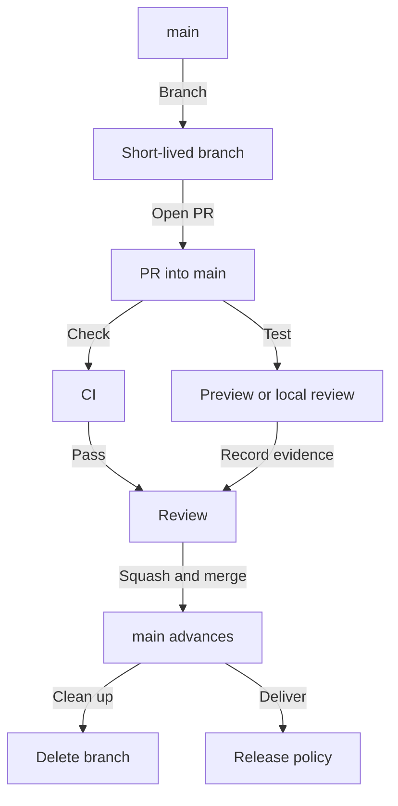

# Branching

Use `main` as the only permanent branch. Branches manage collaboration; environments and release gates control deployment. [ADR-007](../adr/adr-007-main-only-git-workflow.md) records this decision.

## Model

Cut short-lived working branches from `main` and merge them through pull requests. Keep `main` releasable: split unfinished work into safe increments or isolate it behind a disabled feature flag. A merge does not necessarily deploy to production; see [releases](./releases.md).



## Branch names

| Prefix | Use |
| --- | --- |
| `feat/` | New behavior |
| `fix/` | Bug fixes, including urgent production fixes |
| `docs/` | Documentation |
| `chore/` | Tooling and maintenance |
| `refactor/` | Restructuring without changing behavior |
| `test/` | Tests and test support |

Use lowercase kebab-case, such as `feat/add-export` or `fix/42-token-expiration`. A ticket segment is optional. These prefixes describe branches; commit types follow the [commit conventions](./commits.md).

## Rules

- Never commit or push directly to `main`. All changes arrive through a pull request and its checks.
- Keep branches small and short-lived so review and integration remain manageable.
- Start with a clean working tree and an up-to-date `main`.
- Never force-push a shared or protected branch. Rewriting your own unmerged working branch requires coordination with anyone using it; agents also need explicit approval.
- Merge using the [pull-request rules](./pull-requests.md), then delete the head branch. There is no promotion PR or back-sync step.

## Repository topologies

| Mode | Remotes | Working branches live on | PR target |
| --- | --- | --- | --- |
| Direct | `origin` is the shared repo | `origin` | `origin:main` |
| Fork | `origin` is your fork, `upstream` is the shared repo | `origin` | `upstream:main` |

Use fork mode for external contributions and direct mode for solo or small-team repositories with write access.

## Starting a branch

Direct mode:

```bash
git fetch origin
git switch main
git merge --ff-only origin/main
git switch -c feat/add-export
```

Fork mode:

```bash
git fetch upstream
git switch main
git merge --ff-only upstream/main
git switch -c feat/add-export
```

If the fast-forward fails, stop and resolve the divergence without discarding unmerged work. Bring a working branch up to date by merging the owning remote's `main` into it; this avoids rewriting shared commits.

## Migrating existing repositories

Migrate each repository deliberately; changing this handbook does not change another repository's settings.

1. Compare `dev` with `main` and inventory unique changes and open PRs. After squash merges, also compare patches and content because commit ancestry alone can misidentify already merged work.
2. Preserve outstanding work through reviewed PRs into `main`. Review the full diff when retargeting an existing PR; it may include unrelated integration work.
3. Update the default branch, contributor instructions, CI triggers, release automation, and deployment integrations to use `main`. Apply and verify the [protection settings](./branch-protection.md) before retiring the old model.
4. Confirm PR checks and the intended release path work. Remove obsolete promotion and back-sync automation.
5. Retire `dev` only after confirming no unique work, open PRs, or integration depends on it. Branch deletion requires explicit authorization; do not hard-reset or force-push to migrate.

Machine-global Git skills, aliases, templates, and other repositories may still assume `dev` or merge commits. Their migration is separate work; use the manual commands above until those tools follow this standard.
