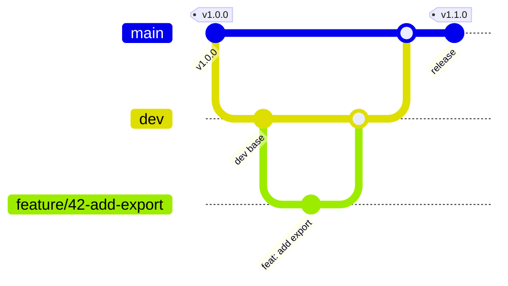

# Branching

## Model

- `main` holds production candidates. Production deploys come from `vX.Y.Z` tags on `main`.
- `dev` is the long-running integration branch.
- Work happens on short-lived named branches cut from `dev` (or from `main` for hotfixes).



## Branch names

| Prefix | Cut from | Merges into | Use |
| --- | --- | --- | --- |
| `feature/<ticket>-<short-desc>` | `dev` | `dev` | New behavior |
| `fix/<ticket>-<short-desc>` | `dev` | `dev` | Non-urgent bug fix |
| `chore/<short-desc>` | `dev` | `dev` | Tooling, docs, maintenance |
| `hotfix/<ticket>-<short-desc>` | `main` | `main`, then back-synced to `dev` | Urgent production fix |

Use lowercase kebab-case. Omit the ticket segment when the repository has no ticket tracker.

## Rules

- Never commit directly on `main` or `dev`. Direct commits skip review and CI.
- Never push directly to `main` or `dev`. All changes arrive through a pull request.
- Never force-push a shared branch. Force-pushing a feature branch is allowed only for your own unmerged work.
- Keep branches short-lived. Long-lived branches turn merges into projects.
- Start from a clean, up-to-date `dev`.

## Repository topologies

| Mode | Remotes | Feature branches live on | PR target |
| --- | --- | --- | --- |
| Direct | `origin` is the shared repo | `origin` | `origin:dev` |
| Fork | `origin` is your fork, `upstream` is the shared repo | `origin` | `upstream:dev` |

Use fork mode for open-source and external contributions. Use direct mode for solo and small-team repositories.

## Starting a branch

Direct mode:

```bash
git fetch origin
git checkout dev
git pull --ff-only origin dev
git checkout -b feature/<ticket>-<short-desc>
```

Fork mode:

```bash
git fetch upstream
git checkout dev
git merge --ff-only upstream/dev
git checkout -b feature/<ticket>-<short-desc>
```

If the fast-forward fails, `dev` has diverged from the shared repository. Stop and resolve that first; do not hard-reset a branch that holds unmerged work.
