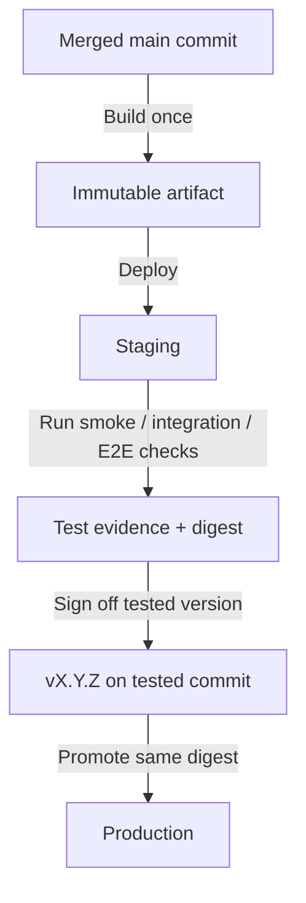

# Releases

Choose the production trigger by delivery needs. All projects use the same [branching model](./branching.md); testing and release control belong in the deployment pipeline.

## Delivery paths

| Project type | After PR checks and review | Production trigger |
| --- | --- | --- |
| Frontend / static website | Merge to `main`; hosted preview preferred before merge | Merge to `main` when automatic publishing is configured |
| Documentation | Merge to `main`; hosted preview preferred before merge | Merge to `main` when automatic publishing is configured |
| Backend / SaaS | Build the merged commit, deploy to staging, run smoke / integration / E2E checks as applicable | `vX.Y.Z` tag on the tested commit, with release sign-off |
| Infrastructure | Validate and review the PR plan; review the production plan for the merged commit | Explicit approval of the production plan, then apply |
| CLI / library | Merge to `main`, verify the release artifact | `vX.Y.Z` tag, then publish |

The static publishing path applies when the repository delegates publishing to its hosting provider, as the [handbook does](../cloud/handbook-deployment.md). If Terraform owns the assets or API image digest, use the reviewed plan/apply path even for frontend content. The existing [deployment profiles](../architecture/deployment-profiles.md) retain that ownership; this standard does not add a competing deployment mechanism.

## Previews and review evidence

Prefer a hosted preview for frontend and documentation changes. Record its URL and tested commit in the PR. If previews are unavailable, build and serve locally, review the changed pages, and record commands, results, and screenshots where useful. Track hosted preview setup as `TBD`; do not claim a preview exists until verified.

For full-stack changes, validate the frontend against a compatible backend in staging or an isolated preview. Keep preview data and credentials separate from production, and do not expose production secrets to untrusted PR code.

## Artifact promotion

The backend/SaaS path promotes one verified artifact. Its release tag identifies the tested commit; production uses the recorded digest.

1. Build the merged `main` commit once. Give the artifact an immutable identity: use the image digest for containers, or a checksum for a package. A commit-based image tag helps discovery but does not replace the digest.
2. Deploy that artifact to staging with environment-specific configuration. Record the commit, artifact digest, and smoke / integration / E2E results together.
3. Sign off the tested version and create `vX.Y.Z` on that exact commit. The tested commit may be older than the current `main` tip. A tag alone does not prove staging passed; the production pipeline must verify the recorded evidence and artifact identity.
4. Promote the recorded artifact to production without rebuilding or resolving a moving branch or image tag. A new commit on `main` must not change a pending release. Revalidate if its artifact or relevant deployment configuration changes.

For SaaS spanning repositories, record the compatible frontend and backend versions in the release evidence. If a frontend build embeds environment values, it is a different artifact when rebuilt for production; use runtime configuration for promotion or explicitly verify the production artifact rather than claiming it is the staged artifact.

Use a protected deployment environment approval where supported. Otherwise require a recorded maintainer sign-off for the exact version before triggering production; do not silently replace approval with an automatic deploy. GitHub environment approval availability depends on the repository visibility and plan. See [GitHub environments](https://docs.github.com/en/actions/how-tos/deploy/configure-and-manage-deployments/manage-environments).

## Infrastructure approvals

Run formatting checks, validation, and a plan for infrastructure PRs. After merge, generate the production plan for the intended commit, target, and inputs; review and approve that plan, then apply the saved plan. If it becomes stale or inputs change, re-plan and obtain approval again. A merge or an application release tag does not authorize production infrastructure changes.

## Versioning and tags

Use [Semantic Versioning](https://semver.org/) for versioned releases: breaking public-contract changes increment major, backward-compatible features increment minor, and backward-compatible fixes increment patch. Preserve `!` and `BREAKING CHANGE:` information in the [squash commit](./pull-requests.md) so release notes and version selection reflect the actual change.

- Tag only a verified commit reachable from `main`; confirm the version and target commit before creating a release tag.
- Never move or delete a published version tag. Correct it with a new version.
- Use tags for backend, SaaS, CLI, and library releases. Routine documentation and portfolio deployments do not need a tag.
- Document whether a tag triggers deployment or publication in each repository. These paths are standards to implement, not a claim that every project's pipeline already exists.

## Rollback and urgent fixes

Restore the previous verified deployment or immutable artifact when production is unhealthy. Check database and configuration compatibility first; an application rollback does not undo a schema migration. Use a forward repair when rollback would be unsafe. Infrastructure rollback requires a new reviewed plan and approved apply.

Correct or revert the source through a `fix/*` PR into `main` so later deployments do not reintroduce the problem. Urgent fixes use the same checks and the project's normal release gate. Do not bypass reviews, move release tags, or introduce a permanent hotfix branch.
