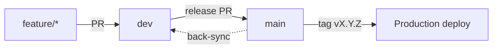

# Releases

Merging to `main` produces a release candidate. A version tag deploys it.

## Flow



1. Merge feature PRs into `dev`.
2. Open a release PR from `dev` into `main`.
3. Merge with a merge commit after required checks and approvals.
4. Tag `main` with `vX.Y.Z` after final sign-off. The tag triggers the production pipeline.
5. Back-sync `dev` from `main`.

## Versioning

Use [Semantic Versioning](https://semver.org/). Breaking changes bump the major version, `feat` bumps minor, `fix` bumps patch.

## Tags

- Tag only `main`.
- Do not tag an unreleased candidate that has not been signed off.
- Never move or delete a published tag. Ship a new patch version instead.

## Back-sync

Merging the release PR advances `main` but not `dev`, so `dev` shows as behind. This is expected. `dev` is protected, so sync it through a pull request, never a direct push.

```bash
git fetch origin
git checkout -b chore/back-sync-main-into-dev origin/dev
git merge --no-ff origin/main -m "Merge main into dev after release"
git push -u origin chore/back-sync-main-into-dev
```

Open a PR from that branch into `dev` and merge it with a merge commit. When `dev` has no commits that `main` lacks, the PR contains only the release merge commit; after a hotfix, it also carries the fix.

## Hotfixes

1. Branch `hotfix/<ticket>-<short-desc>` from `main`.
2. PR into `main`, merge, tag a patch version.
3. Back-sync `dev` through a PR as above. `dev` usually holds unreleased commits by now, so a fast-forward is not possible.
